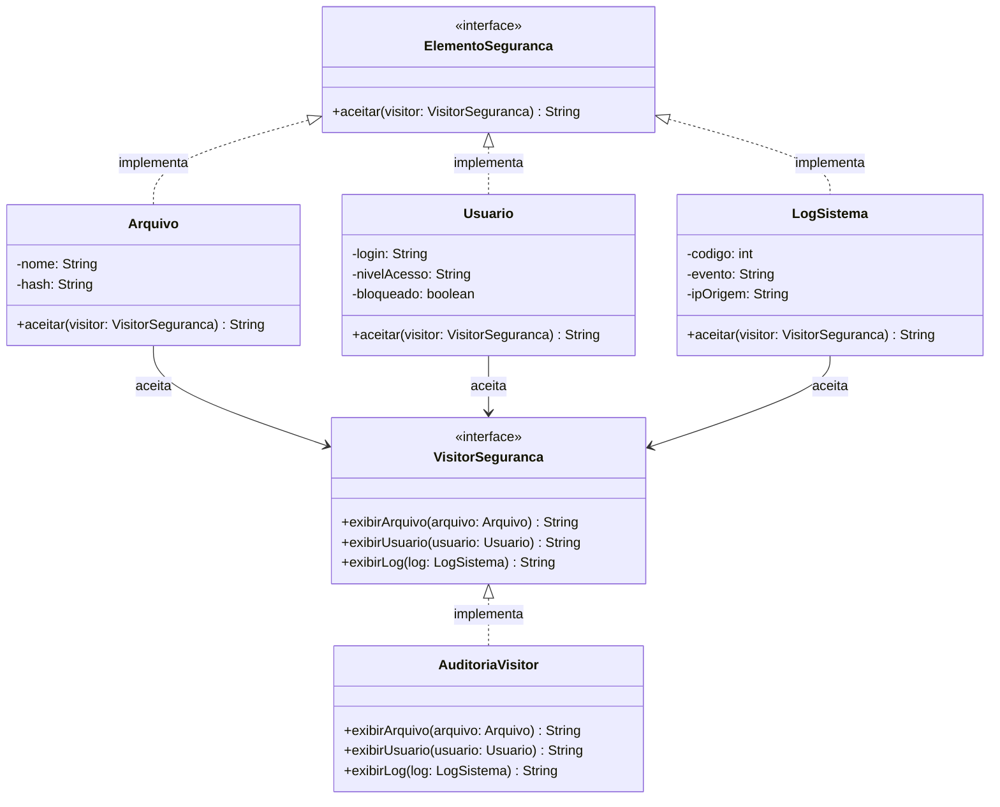

# Padrão Visitor - Sistema de Auditoria de Segurança

[](https://openjdk.java.net/)
[](https://junit.org/junit5/)

Implementação do padrão de projeto **Visitor** (Comportamental) em Java. O projeto demonstra como adicionar novas operações a uma estrutura de objetos estável sem modificar as classes desses objetos, utilizando o mecanismo de *Double Dispatch* (Duplo Despacho).

---

## Descrição e Intenção

**Definição (GoF):** Representar uma operação a ser executada sobre os elementos de uma estrutura de objetos. O Visitor permite definir uma nova operação sem alterar as classes dos elementos sobre os quais ela opera.

### O Problema (A "Explosão" de Métodos)
Em um sistema de segurança, temos elementos estáveis como `Arquivo`, `Usuario` e `LogSistema`. Se precisarmos gerar diferentes tipos de relatórios (Auditoria, Backup, Criptografia, LGPD), teríamos que adicionar um método para cada relatório dentro de cada classe. Isso incha as classes, viola o Princípio da Responsabilidade Única (SRP) e obriga a recompilar todo o sistema quando um novo relatório é criado.

### A Solução
O padrão Visitor extrai a operação para uma classe separada (o *Visitor*). Os elementos (`Arquivo`, `Usuario`, `LogSistema`) apenas "aceitam" o visitante. O visitante sabe exatamente como processar cada elemento concreto. Para criar um novo tipo de auditoria, basta criar uma nova classe Visitor, sem tocar no código dos elementos.

---

## Estrutura do Projeto

```text
src/
├── main/
│   └── padroescomportamentais/visitor/
│       ├── ElementoSeguranca.java       (Interface Element)
│       ├── VisitorSeguranca.java        (Interface Visitor)
│       ├── Arquivo.java                 (Elemento Concreto A)
│       ├── Usuario.java                 (Elemento Concreto B)
│       ├── LogSistema.java              (Elemento Concreto C)
│       └── AuditoriaVisitor.java        (Visitor Concreto)
│
└── test/
    └── padroescomportamentais/visitor/
        └── AuditoriaVisitorTest.java    (Casos de teste)
```

## Diagrama de Classes
O diagrama abaixo ilustra o Double Dispatch. O elemento chama o método específico do visitor passando a si mesmo `(this)`, e o visitor executa a lógica correspondente.



### Análise Crítica: Vantagens e Pontos Cegos

É fundamental entender as limitações do padrão para aplicá-lo corretamente em cenários reais.

#### Vantagens (Fatos)
* **Princípio Aberto/Fechado (OCP):** É possível adicionar infinitas operações (novos Visitors) sem modificar as classes dos elementos existentes.
* **Princípio da Responsabilidade Única (SRP):** A lógica complexa de uma operação específica (ex: cálculo de hash, formatação de relatório) fica isolada na classe Visitor, e não espalhada pelos elementos.
* **Acúmulo de Estado:** O Visitor pode acumular estado enquanto percorre a estrutura de objetos (ex: contar quantos arquivos críticos foram encontrados), algo difícil de fazer com métodos simples nos elementos.

#### Pontos Cegos e Contrapontos (Onde o padrão exige cuidado)
1. **Violação do Encapsulamento:**
   * **Fato:** Para que o Visitor funcione, os elementos frequentemente precisam expor seus dados internos via métodos `get` (getters).
   * **Contraponto:** Se a operação exigir acesso a dados verdadeiramente privados, o Visitor força a classe a "vazar" sua interface. Em sistemas de alta segurança, isso deve ser avaliado com cuidado.
2. **Dificuldade para Adicionar Novos Elementos:**
   * **Fato:** O padrão é aberto para novas operações, mas fechado para novos elementos.
   * **Contraponto:** Se você adicionar um novo elemento (ex: `DispositivoRede`), será obrigado a abrir a interface `VisitorSeguranca` e adicionar o método `exibirDispositivoRede()`, o que quebrará a compilação de todos os Visitors concretos existentes até que sejam atualizados.

---

### Diferença Crucial: Visitor vs. Strategy

Esta é uma confusão comum, pois ambos isolam algoritmos em classes separadas.

| Característica | Padrão Visitor | Padrão Strategy |
| :--- | :--- | :--- |
| **Foco** | Adicionar uma operação a uma estrutura de **múltiplos tipos** de objetos diferentes. | Trocar um algoritmo inteiro para um **único tipo** de contexto. |
| **Mecanismo** | **Double Dispatch**: O elemento e o Visitor colaboram. | **Composição**: O Contexto delega tudo para a Strategy. |
| **Estrutura** | O Visitor tem um método diferente para cada classe concreta. | A Strategy tem a mesma interface para todas as implementações. |
| **Exemplo** | Gerar relatório de Arquivo, Usuário e Log simultaneamente. | Escolher entre Criptografia AES ou RSA para um arquivo. |

---

### Testes

O projeto contém testes unitários (JUnit 5) que validam:
* O `AuditoriaVisitor` consegue processar corretamente um `Arquivo`, um `Usuario` e um `LogSistema`.
* A adição de um novo Visitor (ex: `BackupVisitor`) não exigiria nenhuma alteração nas classes `Arquivo`, `Usuario` ou `LogSistema`.
* O método `aceitar()` delega corretamente para o método específico da interface Visitor.

---

### Tecnologias Utilizadas

| Tecnologia | Versão | Finalidade no Projeto |
| :--- | :--- | :--- |
| **Java** | 21 | Linguagem de programação principal |
| **Maven** | 3.9+ | Gerenciamento de dependências e automação de build |
| **JUnit 5** | 5.9.x | Framework para execução dos testes unitários |
| **Draw.io / Mermaid** | Web | Criação e renderização dos diagramas UML |
